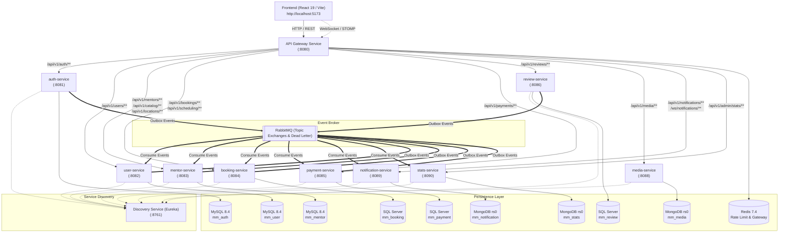

# Mentor-Matching-Microservice

Hệ sinh thái nền tảng kết nối Cố vấn & Học viên (**Mentor Matching Platform**) xây dựng trên kiến trúc **10 Microservices** độc lập, tuân thủ nguyên tắc Domain-Driven Design (DDD), Event-Driven Architecture (EDA) qua Outbox Pattern và Spring Cloud Gateway.

---

## 1. Sơ đồ Kiến trúc Hệ thống

### 1.1 Sơ đồ Tổng quan (Architecture Diagram)



---

## 2. Danh mục 10 Microservices & Cơ sở dữ liệu Sở hữu

| # | Tên Service | Port | DBMS & Tên Database | Phạm vi Chức năng & Trách nhiệm Chính |
|---|---|:---:|---|---|
| 1 | `discovery-service` | `8761` | *Không dùng DB* | Eureka Server quản lý heartbeat và service registry cho toàn cụm. |
| 2 | `api-gateway-service` | `8080` | Redis 7.4 | Điểm vào duy nhất cho Frontend; CORS tập trung, định tuyến bảo mật, rate-limit, WebSocket upgrade `/ws/notifications`. |
| 3 | `auth-service` | `8081` | MySQL 8.4 (`mm_auth`) | Tài khoản, mật khẩu, JWT RS256/JWKS, Refresh Token Family Rotation, phát sự kiện `UserRegisteredEvent`. |
| 4 | `user-service` | `8082` | MySQL 8.4 (`mm_user`) | Hồ sơ Học viên/Người dùng chung, lắng nghe `UserRegisteredEvent` qua Outbox để tự động khởi tạo profile. |
| 5 | `mentor-service` | `8083` | MySQL 8.4 (`mm_mentor`) | Hồ sơ Mentor, môn học, bảng giá, học vấn, KYC duyệt hồ sơ, tìm kiếm Mentor công khai, danh mục môn học (`catalog`) & địa điểm (`location`). |
| 6 | `booking-service` | `8084` | SQL Server (`mm_booking`) | Lịch rảnh mentor (scheduling), đặt lịch học, khoá giữ chỗ chống trùng giờ, vòng đời đơn học (`PENDING`, `CONFIRMED`, `COMPLETED`, `CANCELLED`). |
| 7 | `payment-service` | `8085` | SQL Server (`mm_payment`) | Thanh toán Stripe Sandbox, checkout session, webhook handler, hoàn tiền tự động (Refund Saga) khi hết hạn giữ chỗ. |
| 8 | `review-service` | `8086` | SQL Server (`mm_review`) | Đánh giá & nhận xét sau buổi học, tính toán rating aggregates, phát sự kiện `MentorRatingUpdated` sang Mentor Service. |
| 9 | `media-service` | `8088` | MongoDB rs0 (`mm_media`) | Ký URL upload Cloudinary, xác nhận metadata file ảnh đại diện / chứng chỉ KYC, bảo vệ tài nguyên private. |
| 10 | `notification-service` | `8089` | MongoDB rs0 (`mm_notification`) | Nhận domain events, lưu lịch sử thông báo, đẩy thông báo thời gian thực qua WebSocket (STOMP `/ws/notifications`). |
| 11 | `stats-service` | `8090` | MongoDB rs0 (`mm_stats`) | Thu thập số liệu bất đồng bộ từ các domain service, cung cấp API thống kê Overview & Timeseries cho Admin Dashboard. |

---

## 3. Phân công Thành viên & Ma trận Trách nhiệm (7 Issues / Người)

Dự án được phân chia đều cho 4 thành viên theo quy ước xoay vòng review PR chéo:

| Thành viên | Trách nhiệm chính | Issue phụ trách Code (7 issues) | PR phụ trách Review chéo |
|---|---|---|---|
| **A (Leader)** (`dattran2k4`) | Hạ tầng nền tảng, Discovery, API Gateway, Auth Service, Quy trình Release v1.0.0 | `ISS-01`, `ISS-02`, `ISS-03`, `ISS-04`, `ISS-08`, `ISS-09`, `ISS-28` | `ISS-05`, `ISS-10`, `ISS-13`, `ISS-17`, `ISS-22`, `ISS-24`, `ISS-27` |
| **B** | User Service & Mentor Service (Hồ sơ, Môn học, KYC, Duyệt hồ sơ, Catalog & Location) | `ISS-05`, `ISS-10`, `ISS-11`, `ISS-12`, `ISS-13`, `ISS-14`, `ISS-15` | `ISS-01`, `ISS-04`, `ISS-16`, `ISS-18`, `ISS-20`, `ISS-25` |
| **C** | Media Service & Booking Service (Scheduling, Availabilities, Concurrency hold, Booking lifecycle) | `ISS-06`, `ISS-16`, `ISS-17`, `ISS-19`, `ISS-20`, `ISS-21`, `ISS-22` | `ISS-02`, `ISS-07`, `ISS-09`, `ISS-11`, `ISS-15`, `ISS-23`, `ISS-26`, `ISS-28` |
| **D** | Payment Service, Review Service, Notification Service, Admin Stats Service | `ISS-07`, `ISS-18`, `ISS-23`, `ISS-24`, `ISS-25`, `ISS-26`, `ISS-27` | `ISS-03`, `ISS-06`, `ISS-08`, `ISS-12`, `ISS-14`, `ISS-19`, `ISS-21`, `ISS-28` |

---

## 4. Hướng dẫn Cài đặt & Khởi chạy

### 4.1 Yêu cầu Môi trường
- **Java:** OpenJDK 21 (LTS)
- **Node.js:** v20+ (cho ứng dụng Frontend)
- **Docker & Docker Compose:** Docker Desktop 4.30+
- **Maven:** 3.9+ (hoặc dùng wrapper `./mvnw` có sẵn trong mỗi service)

### 4.2 Khởi chạy Cụm Hạ tầng (Databases & Message Broker)

1. Sao chép file cấu hình môi trường:
   ```sh
   cp .env.example .env
   ```
2. Khởi động các container dữ liệu:
   ```sh
   docker compose up -d
   ```
3. Kiểm tra trạng thái sức khoẻ các container:
   ```sh
   docker compose ps
   ```
   *Đảm bảo các container sau hiển thị trạng thái `healthy`*:
   - `mm-mysql` (Port `3306`)
   - `mm-mssql` (Port `1433`)
   - `mm-mongodb` (Port `27017` - Replica Set `rs0`)
   - `mm-rabbitmq` (Port `5672` & Dashboard `15672`)
   - `mm-redis` (Port `6379`)

### 4.3 Khởi chạy các Microservices

Khởi động các dịch vụ theo thứ tự ưu tiên:

1. **Discovery Service:**
   ```sh
   cd services/discovery-service && ./mvnw spring-boot:run
   ```
   *(Truy cập Dashboard Eureka tại: http://localhost:8761)*

2. **API Gateway Service:**
   ```sh
   cd services/api-gateway-service && ./mvnw spring-boot:run
   ```

3. **Core Identity & Profile Services:**
   - `auth-service` (`:8081`)
   - `user-service` (`:8082`)
   - `mentor-service` (`:8083`)

4. **Booking & Transaction Services:**
   - `booking-service` (`:8084`)
   - `payment-service` (`:8085`)
   - `review-service` (`:8086`)

5. **Support & Operations Services:**
   - `media-service` (`:8088`)
   - `notification-service` (`:8089`)
   - `stats-service` (`:8090`)

---

## 5. Danh sách Tài khoản Mẫu & Dữ liệu Seed

Hệ thống cung cấp sẵn các tài khoản mẫu trong môi trường phát triển (mật khẩu mặc định: `Password123!@#`):

| Vai trò | Email đăng nhập | Mô tả & Quyền hạn |
|---|---|---|
| **Admin** | `admin@mentormatching.vn` | Quản trị viên hệ thống, duyệt KYC mentor, xem thống kê doanh thu toàn sàn. |
| **Mentor 01** | `account16@example.com` | Cố vấn công nghệ thông tin đã được phê duyệt hồ sơ và mở lịch rảnh. |
| **Mentor 02** | `account17@example.com` | Cố vấn ngoại ngữ (IELTS / TOEIC) đang ở trạng thái sẵn sàng nhận lịch. |
| **Learner 01** | `account01@example.com` | Học viên đã xác thực email, dùng để thực hiện luồng đặt lịch & thanh toán. |
| **Learner 02** | `account02@example.com` | Học viên mới đăng ký, dùng để kiểm thử luồng hoàn tất hồ sơ cá nhân. |

---

## 6. Hướng dẫn Tích hợp Frontend & Eventual Consistency

### 6.1 Điểm Kết Nối Tập Trung (Single Gateway Entry)

Ứng dụng Frontend kết nối **duy nhất** qua API Gateway tại địa chỉ `http://localhost:8080`. Tuyệt đối không gọi trực tiếp các port downstream.

- **REST API Base URL:** `http://localhost:8080/api/v1`
- **Realtime WebSocket:** `ws://localhost:8080/ws/notifications` (kết nối STOMP qua SockJS/Native WebSocket, đăng ký nhận tin tại topic `/user/queue/notifications`).
- **CORS & Authentication:**
  - Header: `Authorization: Bearer <accessToken>`
  - Cookie: `refresh_token` (HttpOnly, Secure, SameSite) tự động gửi kèm qua `credentials: 'include'`.

### 6.2 Xử lý Eventual Consistency trên Giao diện

Do hệ thống sử dụng kiến trúc bất đồng bộ (Outbox Pattern & Message Broker), giao diện người dùng cần hỗ trợ các trạng thái chuyển giao:
1. **Sau khi Đăng ký (`/api/v1/auth/register`):**
   - Tài khoản được lưu tại `auth-service` và phát sự kiện `UserRegisteredEvent`.
   - Frontend hiển thị thông báo thành công và chuyển sang màn hình đăng nhập hoặc kiểm tra email xác thực mà không kỳ vọng hồ sơ có ngay lập tức tại `user-service`.
2. **Sau khi Thanh toán Stripe (`Stripe Checkout Callback`):**
   - Webhook của Stripe gửi về `payment-service` -> phát `PaymentSucceeded` -> `booking-service` xác nhận chuyển đơn từ `PENDING` sang `CONFIRMED`.
   - Tại màn hình kết quả thanh toán, UI hiển thị banner: *"Đang xác nhận lịch học..."* kèm hiệu ứng chờ.
   - Khi nhận WebSocket thông báo `BOOKING_CONFIRMED` hoặc polling API `/api/v1/bookings/{id}` đạt trạng thái `CONFIRMED`, giao diện cập nhật trạng thái đơn học thành công ngay lập tức.

---

## 7. Kịch bản Kiểm thử E2E Toàn Luồng (Smoke Test Workflow)

Kịch bản kiểm thử toàn diện từ đầu đến cuối luồng nghiệp vụ:

1. **Bước 1 — Đăng ký & Đăng nhập:**
   - Gọi `POST /api/v1/auth/register` tạo tài khoản Learner và Mentor.
   - Đăng nhập `POST /api/v1/auth/login` lấy JWT Access Token và Refresh Token cookie.
2. **Bước 2 — Xác thực KYC & Phê duyệt Cố vấn:**
   - Mentor tải hồ sơ chứng chỉ qua `POST /api/v1/media/upload-intent` và cập nhật thông tin KYC tại `PUT /api/v1/mentors/me/verification`.
   - Admin đăng nhập, xem danh sách chờ duyệt `GET /api/v1/admin/mentor-verifications/pending` và thực hiện phê duyệt `POST /api/v1/admin/mentor-verifications/{id}/review` với trạng thái `APPROVED`.
3. **Bước 3 — Thiết lập Môn học & Mở Lịch Rảnh:**
   - Mentor thêm môn dạy và giá: `PUT /api/v1/mentors/me/subjects`.
   - Mentor thiết lập ca rảnh trong tuần: `POST /api/v1/scheduling/availabilities`.
4. **Bước 4 — Học viên Tìm kiếm & Đặt lịch:**
   - Học viên tìm mentor: `GET /api/v1/mentors/search?keyword=Java`.
   - Xem lịch rảnh của mentor: `GET /api/v1/mentors/{mentorId}/calendar-booking`.
   - Tạo đơn giữ chỗ: `POST /api/v1/bookings` (Đơn học chuyển sang `PENDING` và kích hoạt thời hạn giữ chỗ 15 phút).
5. **Bước 5 — Thanh toán Stripe Sandbox:**
   - Tạo phiên thanh toán: `POST /api/v1/payments/checkout-session`.
   - Hoàn tất thanh toán trên cổng Stripe -> Stripe Webhook gửi sự kiện `checkout.session.completed` về `POST /api/v1/payments/webhook`.
   - `payment-service` phát sự kiện `PaymentSucceeded` -> `booking-service` xác nhận đơn học `CONFIRMED` -> `notification-service` gửi thông báo cho cả Mentor và Học viên.
6. **Bước 6 — Hoàn thành Buổi học & Đánh giá:**
   - Khi kết thúc giờ học, gọi `POST /api/v1/bookings/{bookingId}/complete`.
   - Học viên gửi đánh giá: `POST /api/v1/reviews` (số sao 1–5, nhận xét, tag chất lượng).
   - `review-service` tính điểm trung bình mới và phát `MentorRatingUpdated` -> `mentor-service` cập nhật ngay điểm sao của Mentor.
7. **Bước 7 — Báo cáo & Thống kê Admin:**
   - Admin truy cập `GET /api/v1/admin/stats/overview` và `GET /api/v1/admin/stats/timeseries` để xem tổng doanh thu phát sinh và biểu đồ số lượng buổi học thành công.

---

## 8. Release v1.0.0

- **Phiên bản:** `v1.0.0`
- **Tình trạng:** Hoàn thành 100% 28 Issues nghiệp vụ (`ISS-01` đến `ISS-28`).
- **Quy chuẩn mã nguồn:** Spring Boot 4.1.2, Java 21, RFC 7807 Problem Details, CQRS Architecture, Outbox Pattern, Event-driven communication qua RabbitMQ.
